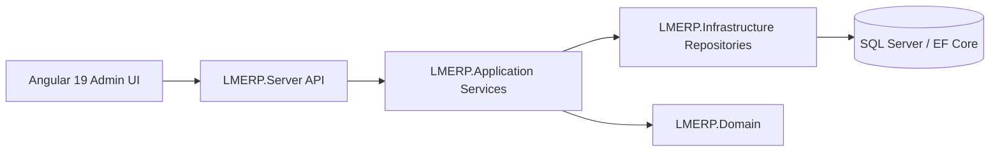

# LMERP System Overview

LMERP is a loan-management application with an ASP.NET Core 8 API, an Angular 19 admin client, and SQL Server persistence through Entity Framework Core.

## Architecture

The backend uses a layered architecture. Requests flow from the Angular client through API controllers and application services to repository abstractions implemented by Infrastructure.



| Project | Responsibility |
| --- | --- |
| `LMERP.Domain` | Core entities, statuses, and domain rules. |
| `LMERP.Application` | Use-case services, request/response contracts, validation, and repository interfaces. |
| `LMERP.Infrastructure` | EF Core `LoanDbContext`, SQL Server queries, Identity persistence, and background late-fee processing. |
| `LMERP.Server` | ASP.NET Core controllers, authentication, authorization, dependency injection, and global API error handling. |
| `lmerp.client` | Angular admin screens, API client, route guards, and authentication interceptor. |
| `LMERP.Tests` | Application and API exception-handling tests. |

## Main Modules

### Authentication and roles

The API uses JWT bearer access tokens and role-based authorization. Login and refresh endpoints are under `/api/auth`. Refresh tokens are stored as hashes in the existing ASP.NET Identity user-token table and rotated when refreshed. The Angular client restores a session, refreshes access tokens, and retries an API request once after a 401 response.

Main roles are Administrator, Loan Officer, Collections Manager, and Analyst. The API remains the authorization boundary even when the UI hides restricted actions.

### Customers

Customer records include contact details, status, and associated loan count. Customer phone numbers are normalized and unique. Customers with loan history cannot be physically deleted; they should be marked inactive instead.

### Loan applications

Loan applications hold the customer, product, amount, tenure, interest terms, application date, and lifecycle status. The lifecycle includes Under review, Documents needed, Approved, Rejected, Disbursed, and Closed. A loan is disbursed only after approval; disbursement creates its EMI schedule. Administrators configure processing and platform fees as separate percentages in Settings. Each percentage is applied to approved principal, rounded independently to cents, and saved as a loan-level snapshot at disbursement. Net cash paid to the customer is principal minus both fees; the EMI schedule continues to amortize the full principal. Existing loans without fee snapshots display principal as the legacy disbursed amount.

Loan application deletion is a soft delete. Deleted loans are excluded by EF Core query filters, while their database records are retained.

### Repayments and collections

Repayments use EMI schedules, payment records, payment allocations, and late-fee records. Payments are allocated to EMI balance first, then to the oldest unpaid late fees. An optional `Idempotency-Key` prevents duplicate payment submissions. Late fees can be waived by administrators; schedules can be exempted from future late fees.

### Loan documents

Successful disbursement persists the EMI rows and an immutable A4 landscape Loan Disbursement Advice & EMI Repayment Schedule PDF in one database transaction. The renderer reads the saved loan and schedule rows and does not recalculate EMI values. It displays the annual nominal interest rate divided by 12 as the monthly rate, and labels the flat/reducing-balance method as the interest type. Monetary schedule headers and values are both right-aligned. The original document number is `DA-{ApplicationNumber}` and is never regenerated after payments. The current loan schema has no separate account number or street address, so the PDF uses the application number as the loan account reference and the customer City field as the available address. The PDF displays principal, each saved fee and rate, and net disbursed amount.

The latest EMI statement is generated on request from current saved payment allocations and schedule rows. Paid amount is based on allocations to the EMI component; outstanding is EMI less that amount. Status is Paid when fully allocated, Overdue when unpaid balance remains after the due date, Partially paid for a partial payment before/during its due date, otherwise Pending. Staff roles can access loan documents. A customer account must be linked by an administrator to a customer record; its signed-in JWT then includes the `customer_id` claim and can access only that customer’s documents. Company name/contact, authorized signatory, disclaimer, logo, signature, and optional stamp are configured in Settings. Uploaded images are restricted to PNG/JPEG up to 2 MB each and stored in SQL Server; PDF endpoints return private, no-store responses.

The collections queue is built from overdue EMI data and includes late fees in the outstanding balance. Dashboard transaction activity includes saved disbursements and recorded repayments.

The disbursement fee settings API is GET/PUT /api/settings/disbursement-fees (Administrator only). Percentages default to 0% and their sum must remain below 100%. Dashboard disbursement totals and transaction rows use the saved net disbursed amount, falling back to principal for legacy records. Schema changes are in migration `20261127122634_AddLoanDisbursementFeeSettings`; apply it with the normal EF Core migration workflow before running the updated application.

### Loan foreclosure

Loan foreclosure is available to Administrator, Loan Officer, and Collections Manager roles at `/foreclosure`. The API searches only active Disbursed loans. The quote includes the customer and loan details, EMI schedule, existing EMI payments and allocations, unpaid late fees, and a calculation date.

Foreclosure charges are configured by administrators in Settings. A default 8% service fee is provided for a new installation, while existing installations retain their saved legacy service-fee percentage when the charge rule is first created. Administrators can add named percentage or fixed-amount charges and taxes, choose a calculation basis (remaining EMI total, outstanding principal, accrued interest, late fees, settlement before charges, service fee, or previous charges), enable or disable each rule, and identify tax lines. The settlement payable is **outstanding principal + accrued interest + unpaid late fees + all enabled configured charges - adjustments**. Each quote displays the individual charge lines; confirmed foreclosure records snapshot each applied charge so later settings changes do not alter historical settlements. Historical EMI payments are split pro rata according to the installment's scheduled principal and interest; simple daily interest accrues at the loan annual rate divided by 365 from disbursement through the quote date, less the interest portion attributed to prior payments. Monetary results are rounded to cents using midpoint-away-from-zero rounding.

The current loan model does not persist separate approved or disbursed amounts; the foreclosure API returns those as unavailable rather than showing the requested amount as if it were an approved/disbursed amount. Existing payment allocations do not preserve principal/interest splits, so foreclosure uses the documented pro-rata rule for historical payment allocation. Review this accounting policy with Finance before production use.

Foreclosure records snapshot the calculation and service-fee percentage. Payments are stored as separate transactions and may be partial. A serializable transaction, unique loan/foreclosure indexes, row version, and optional `Idempotency-Key` protect against duplicate submissions and concurrent updates. A loan and its remaining EMI schedules are marked Foreclosed only after full settlement. During a partial foreclosure, regular EMI collections and late-fee accrual are paused for that loan; the outstanding settlement remains available for additional payments. Historical schedules, late fees, and EMI payments are retained.

Foreclosure settings are available on the Settings screen. Only Administrators can update enablement and charge rules. Percentage charges accept 0–100%; fixed charges accept non-negative amounts. Exactly one service-fee rule is required, and the default service-fee basis is remaining unpaid EMI total.

The Angular Settings page normalizes legacy settings responses that do not contain charge rules to a single service-fee row, preventing editor actions from failing on an undefined list. It detects that older API response and does not claim dynamic rules were saved; the backend must be restarted with the dynamic-charge build and migration before saving additional rules.

### Dashboard and supporting screens

Dashboard totals come from `/api/dashboard/summary`; recent applications come from `/api/loans`; recent transactions come from `/api/dashboard/recent-transactions`. Monthly application and status summaries are derived from saved loan records. Reports, users, and settings remain separate admin screens and should be checked against their current API support before treating their actions as persisted workflows.

## API Error Handling

`LMERP.Server.ExceptionHandling.GlobalExceptionHandler` implements ASP.NET Core's `IExceptionHandler` and is registered through `AddExceptionHandler<GlobalExceptionHandler>()`. `AddProblemDetails()` is registered, and `UseExceptionHandler()` is placed early in the HTTP pipeline.

The handler reuses the existing application exceptions and maps them as follows:

| Condition | HTTP status |
| --- | ---: |
| Missing resource (`NotFoundException`) | 404 |
| Domain or data-annotation validation failure | 400 |
| Business conflict (`ConflictException`) | 409 |
| EF concurrency conflict | 409 |
| SQL Server unique-key violation | 409 |
| Unexpected exception | 500 |
| Authentication challenge / access denied | 401 / 403 |

Error responses use `ProblemDetails` and include a trace ID. To preserve Angular compatibility, the body also includes `success`, `message`, `data`, and `errors` fields. Expected API failures return a safe message. Unexpected exceptions are logged server-side with full exception details; clients receive a generic message and never receive stack traces, SQL errors, or internal exception text.

Normal application outcomes represented by `OperationResult` continue to use the existing `BaseResponse<T>` error envelope. This avoids changing established controller behavior while the exception pipeline handles thrown failures centrally.

### Example unexpected error response

```json
{
  "type": "",
  "title": "Internal server error",
  "status": 500,
  "detail": "An unexpected error occurred. Please try again later.",
  "instance": "/api/loans/42",
  "success": false,
  "message": "An unexpected error occurred. Please try again later.",
  "data": null,
  "errors": [],
  "traceId": "00-..."
}
```

The response also carries the `X-Correlation-ID` header. Use its value or `traceId` when finding the corresponding server log entry.

## API Routes

| Area | Routes |
| --- | --- |
| Authentication | `POST /api/auth/login`, `POST /api/auth/refresh`, `POST /api/auth/logout` |
| Dashboard | `GET /api/dashboard/summary`, `GET /api/dashboard/recent-transactions` |
| Customers | `GET/POST /api/customers`, `GET/PUT/DELETE /api/customers/{id}` |
| Loans | `GET/POST /api/loans`, `GET/PUT/DELETE /api/loans/{id}`, `GET /api/loans/{id}/emi-schedule`, `POST /api/loans/{id}/disburse`, `POST /api/loans/{id}/reject` |
| Repayments | `GET /api/repayments/overdue`, `GET /api/repayments/summary`, `GET /api/repayments/emi/{scheduleId}`, `GET/POST /api/repayments/emi/{scheduleId}/payments` |
| Late fees and products | `POST /api/repayments/late-fees/{feeId}/waive`, `POST /api/repayments/emi/{scheduleId}/exempt-late-fees`, `GET/POST /api/repayments/products`, `PUT /api/repayments/products/{id}` |
| Foreclosure | `GET /api/foreclosures/loans/{loanNumber}`, `GET /api/foreclosures?loanNumber=...`, `POST /api/foreclosures/loans/{loanNumber}`, `POST /api/foreclosures/{foreclosureId}/payments`, `GET/PUT /api/foreclosures/settings` |
| Loan documents | `GET /api/documents/loans/{loanId}/disbursement-advice`, `GET /api/documents/loans/{loanId}/emi-statement`, `GET/PUT /api/documents/settings`, `GET /api/documents/settings/assets/{assetName}`, `PUT /api/documents/customer-links/{userId}` (Administrator) |

## Running and Verifying

From the repository root:

```powershell
dotnet run --project .\LMERP.Server\LMERP.Server.csproj
dotnet test .\LMERP.Tests\LMERP.Tests.csproj
```

Build the Angular client from its project directory:

```powershell
Set-Location .\lmerp.client
npm ci
npm run build
```

Schema changes use EF Core code-first migrations in `LMERP.Infrastructure/Persistence/Migrations`. Foreclosure records are added by `AddLoanForeclosure`; dynamic charge rules and charge snapshots are added by `AddDynamicForeclosureCharges`; company document settings and immutable disbursement PDFs are added by `AddLoanDisbursementDocuments`. Startup migration applies them through the existing `Database.MigrateAsync()` setup. Review generated migrations before applying them to a shared or production database.
