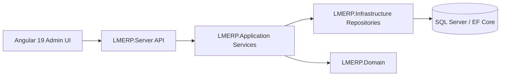

# LMERP System Overview

LMERP is a loan-management application with an ASP.NET Core 8 API, an Angular 19 admin client, and SQL Server persistence through Entity Framework Core.

## Architecture

The backend uses a layered architecture. Requests flow from the Angular client through API controllers and application services to repository abstractions implemented by Infrastructure.



| Project | Responsibility |
| --- | --- |
| `LMERP.Domain` | Core entities, statuses, and domain rules. |
| `LMERP.Application` | Use-case services, request/response contracts, validation, and repository interfaces. |
| `LMERP.Infrastructure` | EF Core `LoanDbContext`, SQL Server queries, Identity persistence, and background late-fee processing. |
| `LMERP.Server` | ASP.NET Core controllers, authentication, authorization, dependency injection, and global API error handling. |
| `lmerp.client` | Angular admin screens, API client, route guards, and authentication interceptor. |
| `LMERP.Tests` | Application and API exception-handling tests. |

## Main Modules

### Authentication and roles

The API uses JWT bearer access tokens and role-based authorization. Login and refresh endpoints are under `/api/auth`. Refresh tokens are stored as hashes in the existing ASP.NET Identity user-token table and rotated when refreshed. The Angular client restores a session, refreshes access tokens, and retries an API request once after a 401 response.

Main roles are Administrator, Loan Officer, Collections Manager, and Analyst. The API remains the authorization boundary even when the UI hides restricted actions.

### Customers

Customer records include contact details, status, and associated loan count. Customer phone numbers are normalized and unique. Customers with loan history cannot be physically deleted; they should be marked inactive instead.

### Loan applications

Loan applications hold the customer, product, amount, tenure, interest terms, application date, and lifecycle status. The lifecycle includes Under review, Documents needed, Approved, Rejected, Disbursed, and Closed. A loan is disbursed only after approval; disbursement creates its EMI schedule.

Loan application deletion is a soft delete. Deleted loans are excluded by EF Core query filters, while their database records are retained.

### Repayments and collections

Repayments use EMI schedules, payment records, payment allocations, and late-fee records. Payments are allocated to EMI balance first, then to the oldest unpaid late fees. An optional `Idempotency-Key` prevents duplicate payment submissions. Late fees can be waived by administrators; schedules can be exempted from future late fees.

The collections queue is built from overdue EMI data and includes late fees in the outstanding balance. Dashboard transaction activity includes saved disbursements and recorded repayments.

### Dashboard and supporting screens

Dashboard totals come from `/api/dashboard/summary`; recent applications come from `/api/loans`; recent transactions come from `/api/dashboard/recent-transactions`. Monthly application and status summaries are derived from saved loan records. Reports, users, and settings remain separate admin screens and should be checked against their current API support before treating their actions as persisted workflows.

## API Error Handling

`LMERP.Server.ExceptionHandling.GlobalExceptionHandler` implements ASP.NET Core's `IExceptionHandler` and is registered through `AddExceptionHandler<GlobalExceptionHandler>()`. `AddProblemDetails()` is registered, and `UseExceptionHandler()` is placed early in the HTTP pipeline.

The handler reuses the existing application exceptions and maps them as follows:

| Condition | HTTP status |
| --- | ---: |
| Missing resource (`NotFoundException`) | 404 |
| Domain or data-annotation validation failure | 400 |
| Business conflict (`ConflictException`) | 409 |
| EF concurrency conflict | 409 |
| SQL Server unique-key violation | 409 |
| Unexpected exception | 500 |
| Authentication challenge / access denied | 401 / 403 |

Error responses use `ProblemDetails` and include a trace ID. To preserve Angular compatibility, the body also includes `success`, `message`, `data`, and `errors` fields. Expected API failures return a safe message. Unexpected exceptions are logged server-side with full exception details; clients receive a generic message and never receive stack traces, SQL errors, or internal exception text.

Normal application outcomes represented by `OperationResult` continue to use the existing `BaseResponse<T>` error envelope. This avoids changing established controller behavior while the exception pipeline handles thrown failures centrally.

### Example unexpected error response

```json
{
  "type": "",
  "title": "Internal server error",
  "status": 500,
  "detail": "An unexpected error occurred. Please try again later.",
  "instance": "/api/loans/42",
  "success": false,
  "message": "An unexpected error occurred. Please try again later.",
  "data": null,
  "errors": [],
  "traceId": "00-..."
}
```

The response also carries the `X-Correlation-ID` header. Use its value or `traceId` when finding the corresponding server log entry.

## API Routes

| Area | Routes |
| --- | --- |
| Authentication | `POST /api/auth/login`, `POST /api/auth/refresh`, `POST /api/auth/logout` |
| Dashboard | `GET /api/dashboard/summary`, `GET /api/dashboard/recent-transactions` |
| Customers | `GET/POST /api/customers`, `GET/PUT/DELETE /api/customers/{id}` |
| Loans | `GET/POST /api/loans`, `GET/PUT/DELETE /api/loans/{id}`, `GET /api/loans/{id}/emi-schedule`, `POST /api/loans/{id}/disburse`, `POST /api/loans/{id}/reject` |
| Repayments | `GET /api/repayments/overdue`, `GET /api/repayments/summary`, `GET /api/repayments/emi/{scheduleId}`, `GET/POST /api/repayments/emi/{scheduleId}/payments` |
| Late fees and products | `POST /api/repayments/late-fees/{feeId}/waive`, `POST /api/repayments/emi/{scheduleId}/exempt-late-fees`, `GET/POST /api/repayments/products`, `PUT /api/repayments/products/{id}` |

## Running and Verifying

From the repository root:

```powershell
dotnet run --project .\LMERP.Server\LMERP.Server.csproj
dotnet test .\LMERP.Tests\LMERP.Tests.csproj
```

Build the Angular client from its project directory:

```powershell
Set-Location .\lmerp.client
npm ci
npm run build
```

Schema changes use EF Core code-first migrations in `LMERP.Infrastructure/Persistence/Migrations`. Review generated migrations before applying them to a shared or production database.
