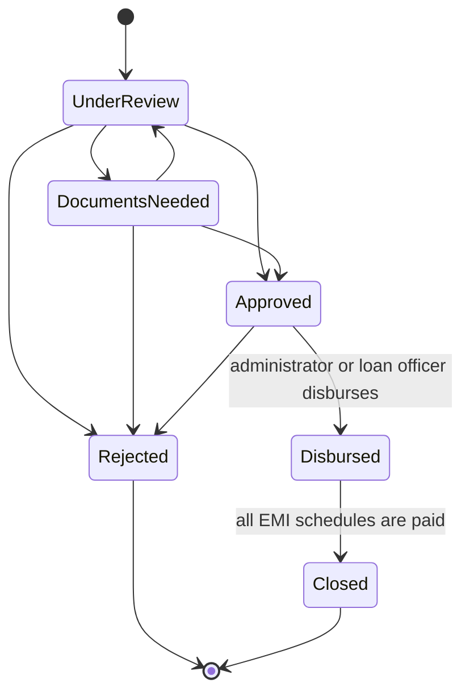

# Northstar Lending Admin

An ASP.NET Core 8 and Angular 19 starter for a loan management admin workspace.

## Current implementation

- Responsive Angular admin shell with dashboard, customer, loan, repayment, collection, reports, users, and settings screens.
- SQL Server persistence for customers, loan applications, products, EMI schedules, payments, allocations, and late fees.
- JWT authentication with access-token expiry, security-stamp validation, login rate limiting, and role-checked APIs.
- Dashboard totals and overdue balances are aggregated by SQL queries. Repayments and collections screens remain mock UI.

## Server layers

- `LMERP.Domain` contains the loan and customer entities.
- `LMERP.Application` contains request/response DTOs, use-case services, and repository abstractions.
- `LMERP.Infrastructure` contains Entity Framework Core, SQL Server persistence, Identity, and repository implementations.
- `LMERP.Server` is the API/presentation layer: controllers, authentication, validation, middleware, and dependency wiring.

All API endpoints use `BaseResponse<T>` with the same envelope:

```json
{
  "success": true,
  "message": "Request completed.",
  "data": {},
  "errors": []
}
```

Validation, authorization, not-found, conflict, and exception responses use the same fields and include error messages in `errors` where applicable.

## Configure local access

The repository contains no bootstrap credentials or machine-specific database connection strings. Configure local access outside tracked files with user secrets or environment variables.

Set the LocalDB connection string and a JWT signing key using user secrets (the signing key shown here is generated locally):

```powershell
dotnet user-secrets set "ConnectionStrings:LoanDb" "Server=(localdb)\MSSQLLocalDB;Database=NorthstarLending;Trusted_Connection=True;MultipleActiveResultSets=true;TrustServerCertificate=True" --project .\LMERP.Server\LMERP.Server.csproj
dotnet user-secrets set "Jwt:SigningKey" ([Convert]::ToBase64String([Security.Cryptography.RandomNumberGenerator]::GetBytes(48))) --project .\LMERP.Server\LMERP.Server.csproj
```

Create an administrator using local user secrets (replace the example values):

```powershell
dotnet user-secrets set "BootstrapAdmin:Email" "admin@example.com" --project .\LMERP.Server\LMERP.Server.csproj
dotnet user-secrets set "BootstrapAdmin:Password" "<a-new-unique-password>" --project .\LMERP.Server\LMERP.Server.csproj
```

The password must be at least 12 characters and include upper and lower case letters, a number, and a symbol. User secrets stay outside the repository. In Development, the server generates an ephemeral JWT signing key if one is not configured. Environment variable names use double underscores, for example `ConnectionStrings__LoanDb`, `Jwt__SigningKey`, `BootstrapAdmin__Email`, and `BootstrapAdmin__Password`. For production, configure a stable signing key and database connection in a secret store and supply bootstrap admin values only when an initial administrator needs to be created.

## Run

From the solution folder:

```powershell
dotnet run --project .\LMERP.Server\LMERP.Server.csproj
```

The ASP.NET Core SPA proxy starts the Angular development server. Open the frontend URL shown in the console. The Swagger UI is available from the development server at `/swagger`.

For a standalone client build:

```powershell
cd .\lmerp.client
npm ci
npm run build
npm test -- --watch=false --browsers=ChromeHeadlessNoGpu
```

The headless launcher disables GPU acceleration for environments where Chrome cannot initialize its GPU process.

## API overview

All endpoints return the `BaseResponse<T>` envelope.

| Method | Endpoint | Purpose |
| --- | --- | --- |
| `POST` | `/api/auth/login` | Sign in (limited by remote IP) |
| `GET` | `/api/dashboard/summary` | Dashboard totals and overdue amount |
| `GET`, `POST` | `/api/customers` | List and create customers |
| `GET`, `PUT`, `DELETE` | `/api/customers/{id}` | Read, update, or delete a customer |
| `GET`, `POST` | `/api/loans` | List and create loan applications |
| `GET`, `PUT`, `DELETE` | `/api/loans/{id}` | Read, update, or archive an application |
| `GET` | `/api/loans/{id}/emi-schedule` | Read an application schedule |
| `POST` | `/api/loans/{id}/disburse` | Disburse an approved application and create its schedule |
| `POST` | `/api/loans/{id}/reject` | Reject an application with a reason |
| `GET` | `/api/repayments/overdue` | List overdue installments |
| `GET` | `/api/repayments/summary` | Repayment summary totals |
| `GET` | `/api/repayments/emi/{scheduleId}` | Read an installment, fees, and payments |
| `GET` | `/api/repayments/emi/{scheduleId}/payments` | List payments for an installment |
| `POST` | `/api/repayments/emi/{scheduleId}/payments` | Record a payment; optional `Idempotency-Key` header (1–64 characters) |
| `POST` | `/api/repayments/late-fees/{feeId}/waive` | Waive the unpaid remainder of a late fee |
| `POST` | `/api/repayments/emi/{scheduleId}/exempt-late-fees` | Exempt an installment from future late fees |
| `GET` | `/api/repayments/products` | List active loan products |
| `POST`, `PUT` | `/api/repayments/products[/{id}]` | Manage loan product late-fee settings |

## Role matrix

| Capability | Administrator | Loan Officer | Collections Manager | Analyst |
| --- | :---: | :---: | :---: | :---: |
| Dashboard | Yes | Yes | Yes | Yes |
| Read customers and loans | Yes | Yes | Yes | Yes |
| Create/update customers and loans | Yes | Yes | No | No |
| Archive customers/loans | Yes | No | No | No |
| Disburse or reject loans | Yes | Yes | No | No |
| Read repayment data and active products | Yes | Yes | Yes | No |
| Record payments | Yes | Yes | Yes | No |
| Waive fees, exempt installments, manage products | Yes | No | No | No |
| Users and settings routes | Yes | No | No | No |

The client hides role-restricted actions, while API authorization remains the enforcement boundary. The Repayments and Collections screens are still mock UI.

## Configuration

| Key | Default / use |
| --- | --- |
| `Jwt:Issuer`, `Jwt:Audience` | Token validation values |
| `Jwt:SigningKey` | Secret of at least 32 bytes; use a secret store outside Development |
| `Jwt:AccessTokenMinutes` | `60` minutes |
| `RateLimiting:Login:PermitLimit` | `5` attempts |
| `RateLimiting:Login:WindowSeconds` | `60` seconds |
| `Customers:DefaultCountryCode` | `+91` for ten-digit customer phone numbers |
| `AllowedHosts` | `localhost` in the checked-in local settings; production must list its real host names |
| `LateFeeProcessing:BusinessTimeZoneId` | `Asia/Kolkata` unless configured otherwise |

When hosted behind a reverse proxy, configure forwarded headers before rate limiting so requests are partitioned by the real client IP.

## Loan lifecycle



EMI schedules are generated at disbursement. Due dates are the disbursement timestamp plus one or more calendar months; `DateTimeOffset.AddMonths` clamps dates to the target month end.

## EF Core migrations

The server runs `Database.MigrateAsync()` at startup. For a schema change, from the solution directory:

```powershell
dotnet ef migrations add <MigrationName> --project .\LMERP.Infrastructure --startup-project .\LMERP.Server --context LMERP.Infrastructure.Persistence.LoanDbContext
dotnet build .\LMERP.sln
dotnet ef migrations list --project .\LMERP.Infrastructure --startup-project .\LMERP.Server --context LMERP.Infrastructure.Persistence.LoanDbContext
dotnet ef database update --project .\LMERP.Infrastructure --startup-project .\LMERP.Server --context LMERP.Infrastructure.Persistence.LoanDbContext
```

Review every generated migration before applying it. Test data-fix SQL on a production-like database copy, especially the phone normalization collision check and lifecycle status backfill. Back up the database before production migrations and deploy schema changes before the application version that depends on them.

## Follow-ups and migration notes

- Refresh tokens and moving access tokens to HttpOnly cookies are not implemented.
- Payment reversal/refund is not implemented.
- Repayments and Collections UIs are still mock screens.
- A foreign key from `LoanApplication.Product` to `LoanProduct`, pagination, and enums for schedule/fee statuses remain future work.
- The lifecycle migration estimates old disbursement dates as one month before the earliest EMI due date. Confirm this approximation with business owners before production rollout.
